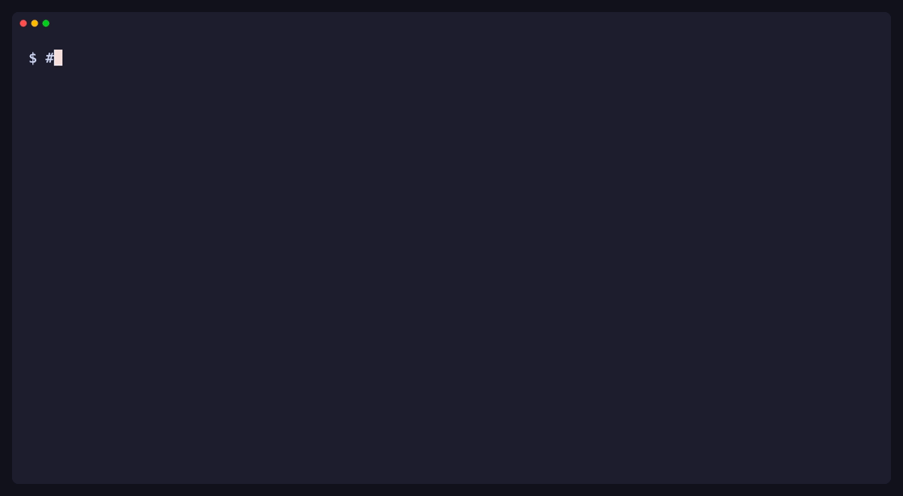
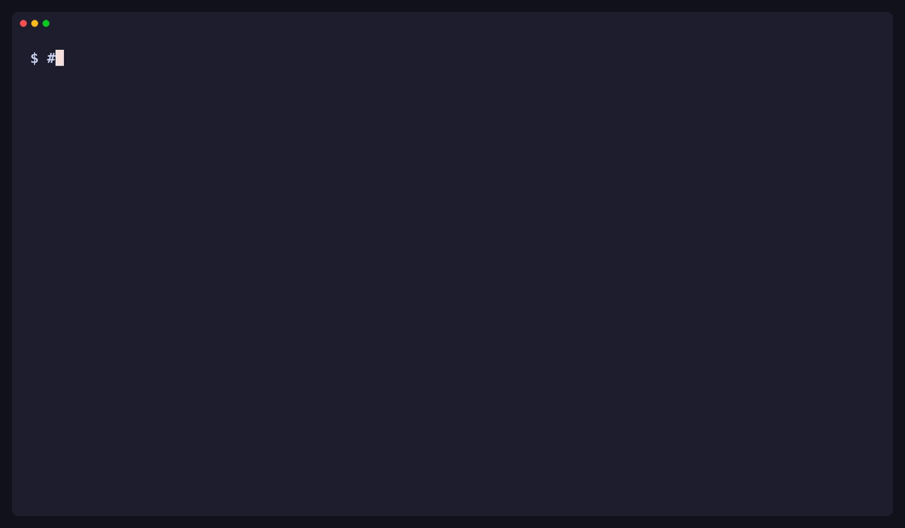

# stagelatch

**A quality gate that judges the commit you are making, not the files on your disk.**

Change-aware checks for Flutter and Dart repositories. One engine runs on
`git commit`, on `git push` and on the pull request.

[](https://pub.dev/packages/stagelatch)
[](https://pub.dev/packages/stagelatch/score)
[](https://github.com/danielcbdev/stagelatch/actions/workflows/ci.yaml)
[](LICENSE)

[Why](#why-stagelatch) ·
[See it work](#see-it-work) ·
[Quick start](#quick-start) ·
[What it checks](#what-it-checks) ·
[Configuration](#configuration) ·
[Existing projects](#adopting-it-in-an-existing-project) ·
[CI](#ci) ·
[Benchmark](#benchmark)


## Why stagelatch

A pre-commit hook that runs `dart format` and `dart analyze` looks at your
working tree, not at the commit. With `git add -p`, an unstaged edit can hide
an error that is being committed, or report one that is not. Stashing to work
around it rewrites your working tree under you.

stagelatch judges exactly what is being published:

| Entry point | What is judged |
|---|---|
| `git commit` | the index |
| `git push` | the commit being pushed |
| pull request (`stagelatch ci`) | the head of the pull request |

- **The exact snapshot.** It reads file content from git and runs your
  project's own SDK on a copy of that snapshot. Its verdict is what
  `dart format` and `dart analyze` would say about the commit itself.
- **Only what changed.** It looks at the files the change touches and, for
  analysis and tests, the files that import them.
- **The same engine everywhere.** The hooks are fast feedback; the guarantee
  is `stagelatch ci` on the pull request. No network, no telemetry and no AI
  in the blocking path: the same input gives the same result on any machine.

|  | `dart format` and `dart analyze` in a hook | stagelatch |
|---|---|---|
| What it judges | the working tree | the index, the pushed commit, the pull request head |
| Partial staging (`git add -p`) | unstaged edits leak into the verdict | only staged content counts |
| Scope | the whole project, or a file list you maintain | the change and the files that import it |
| Beyond format and analyze | not covered | pubspec, codegen, l10n, assets, secrets and tests checks |

## See it work

### Format problems are fixed in the index

On commit, stagelatch formats the staged copy of a Dart file and writes the
fix to the index. The file on disk is rewritten only if it has no unstaged
changes, so work in progress is never touched.

### Mistakes are blocked before they reach the repository



Every finding has a rule ID, a file, a line and a column. You can change a
rule's severity in `stagelatch.yaml`, or silence one finding where it is with
`// stagelatch:ignore <rule-id>`.

### The push runs your SDK's analyzer on what is being pushed



The same checks run on the pull request. In GitHub Actions the `github`
reporter turns each finding into an annotation on the diff:

```
::error file=lib/label.dart,line=1,col=8,endLine=1,endColumn=17,title=analyze/unused_import::Unused import: 'dart:io'.
```

### Two commands that explain what is going on

`stagelatch doctor` diagnoses hooks, `core.hooksPath`, the resolved SDK, the
`PATH` and `min_version`. This is a shortened real run:

```
ok    D1 git 2.54.0
ok    D3 Hooks directory: /work/app/.git/hooks
warn  D4 pre-commit hook is missing. Run: stagelatch install
ok    D7 stagelatch.yaml is valid.
ok    D8 Dart SDK 3.13.4 at /sdk/dart-sdk (PATH)
```

`stagelatch why <test-file>` explains why `tests/affected` would select a test,
without starting a test process:

```
test/checkout/cart_test.dart is affected by 1 changed file:

lib/checkout/cart.dart (changed)
  imported by lib/checkout/cart_controller.dart
  imported by test/checkout/cart_test.dart
```

## Quick start

stagelatch needs git and Dart `^3.13.0`, and runs on Linux, macOS and Windows.

**1. Install it** as a global tool, not as a `dev_dependency`: it is a tool,
not part of your app's dependency graph.

```sh
dart pub global activate stagelatch
```

**2. Set up your repository.** In a git repository with a `pubspec.yaml`,
after `dart pub get`:

```sh
stagelatch init
```

`init` detects your stack, writes `stagelatch.yaml` and installs the
`pre-commit` and `pre-push` hooks. It never asks a question when it has no
terminal, so it is safe in scripts and CI.

**3. Work as usual.**

- `git commit` formats the staged Dart files in the index (unstaged edits are
  left alone) and blocks on pubspec and sensitive-file problems;
- `git push` runs your SDK's `dart analyze` on what is being pushed, and runs
  the tests that the change affects when the working tree matches the pushed
  commit for those files.

`stagelatch doctor` explains what is installed and what is missing.
`stagelatch uninstall` removes the hooks stagelatch installed and restores
any hook it backed up. A machine without stagelatch skips the hooks with a
warning instead of blocking, which is why CI is the guarantee.

## What it checks

| Check | Catches | Runs on |
|---|---|---|
| `format` | `format/unformatted`: a changed Dart file is not formatted (fixed in the index) | commit |
| `analyze` | `analyze/<code>`: a diagnostic from your SDK's analyzer in a changed file or in one that imports it | push, CI |
| `pubspec` | `path-dependency`, `dependency-overrides`, `unpinned-git`, `build-number-regression`, `lockfile-out-of-sync`, `unparseable` | commit |
| `codegen` | `codegen/stale`: a generated file (`.g.dart`, `.freezed.dart`) was not updated with its source | commit |
| `l10n` | `missing-key`, `placeholder-mismatch`, `unused-key` (warning), `unparseable` | commit |
| `assets` | `missing`, `undeclared`, `max-file-size` | commit |
| `sensitive-files` | `signing` (keystores, `.p8`, `.p12`, `key.properties`) and `credentials` (`.env` files, service account keys) | commit |
| `tests` | `solo`, `new-skip` (warning; old skips are never reported) and `affected` | commit; `affected` on push, CI |

Every rule, its trigger and its default severity are in the
[rule reference](docs/rules.md). The SDK is the one your project uses:
`sdk_path` in `stagelatch.yaml`, then FVM (`.fvmrc`, `.fvm/flutter_sdk`), then
`dart` on `PATH`.

### `tests/affected`

On push and in CI, stagelatch selects the test files the change touches and
the test files that import a changed or deleted file, directly or through
other files. It runs them with your package's `dart test` or `flutter test`.
It never runs on commit: a commit hook that started the suite would be too
slow, and the guarantee is `stagelatch ci` on the pull request.

Before the first test process starts, and again after the last one, it checks
that the working tree matches the snapshot for every file those tests import.
If anything differs (an unstaged edit, an untracked file a test imports, or a
push of a branch that is not checked out), the suite is skipped with a warning
and the push is allowed. A green run means those files matched.

Selection follows `import`, `export` and `part`. It does not see fixtures,
goldens, assets or other data files that no import reaches. The details are
in [ADR-0018](docs/adr/0018-affected-tests-run-against-validated-snapshot.md).

Pub workspaces are supported. Syntactic facts about your files are cached
under `<git common dir>/stagelatch/cache`, which is `.git/stagelatch/cache`
in a plain clone. It is safe to delete at any time.

## Configuration

`stagelatch init` writes only the checks that fit your project: `codegen` when
`build_runner` is a dev dependency, `l10n` when there is an `l10n.yaml`,
`assets` when a pubspec declares assets. The file starts with a
`yaml-language-server` comment, so editors complete and validate its keys from
[`schema/stagelatch.schema.json`](schema/stagelatch.schema.json).

```yaml
min_version: 1.0.0

hooks:
  pre-commit: [format, codegen, pubspec, l10n, assets, sensitive-files, tests/solo, tests/new-skip]
  pre-push: [analyze, tests/affected]
  # ci: defaults to the union of the two lists above.

rules:
  l10n/unused-key: warning
  tests/new-skip: off              # error | warning | off

exclude: [lib/generated/**]

format:
  fix: true

analyze:
  scope: affected                  # changed | affected | all
  fail_on: [error, warning]

pubspec:
  monotonic_build_number: [release/*]

assets:
  max_file_size: 500KB
  ignore: [assets/videos/**]

baseline: .stagelatch/baseline.json
```

A finding can be silenced where it is, with its rule ID:
`// stagelatch:ignore analyze/unused_import` in Dart or
`# stagelatch:ignore pubspec/dependency-overrides` in YAML, on the line or the
line before. The full reference is [`docs/specs/config.md`](docs/specs/config.md).

## Adopting it in an existing project

A legacy codebase has findings you cannot fix today. `run` and `ci` take
`--all` to judge every file of the snapshot, not only the changed ones, and a
baseline records what is already there so that only new findings block:

```sh
stagelatch run pre-commit --all    # see everything the checks would report
stagelatch baseline create         # record today's findings
git add .stagelatch/baseline.json  # the baseline counts once it is staged
git commit -m "chore: adopt stagelatch"
```

An entry is the rule, the file and a fingerprint of the offending code, so
inserting lines above a finding keeps it accepted, while editing the code or
renaming the file brings it back. When you fix findings, `stagelatch baseline
prune` drops the entries that no longer match; it never adds entries.
`baseline create` refuses to overwrite a file; pass `--force` to start over.

## CI

The hooks are fast feedback; the guarantee is the same engine on the pull
request. A minimal GitHub Actions job:

```yaml
- uses: actions/checkout@v4
  with:
    fetch-depth: 0          # stagelatch ci needs the merge base
- uses: dart-lang/setup-dart@v1
- run: dart pub get
- uses: danielcbdev/stagelatch@v1.0.1
  with:
    base: origin/${{ github.base_ref }}
```

Findings appear as annotations on the pull request. For other tools,
`stagelatch ci --reporter json` gives scripts and AI agents the same result as
JSON, and `--reporter junit` prints JUnit XML. For code scanning, write SARIF
to a file with the action's `output` input and upload it (pin third-party
actions to a full commit SHA):

```yaml
- uses: danielcbdev/stagelatch@v1.0.1
  with:
    base: origin/${{ github.base_ref }}
    reporter: sarif
    output: stagelatch.sarif
- uses: github/codeql-action/upload-sarif@2d92b76c45b91eb80fc44c74ce3fce0ee94e8f9d # v3.30.0
  with:
    sarif_file: stagelatch.sarif
```

**Pull requests from forks.** With `tests/affected`, `stagelatch ci` executes
the pull request's tests and the code they import, like a `dart test` step.
Use the `pull_request` trigger, never `pull_request_target`, and keep the
usual restrictions on secrets. When `custom_checks` are configured, `ci` also
starts those child processes (project code from the branch), so pass
`--no-custom-checks` (or the action input `no-custom-checks: true`) so
untrusted check code does not run.

## Custom checks

You can declare out-of-process checks under `custom_checks:` in
`stagelatch.yaml`. Each check is a separate process that speaks protocol 1
(line-delimited JSON), so you can write one in any language. There is no
`stagelatch_core` package: copy [`example/custom_check/`](example/custom_check/)
and follow [`docs/custom-checks.md`](docs/custom-checks.md). The contract is in
[`docs/specs/custom-checks.md`](docs/specs/custom-checks.md), and what stays
stable across releases is in [`docs/stability.md`](docs/stability.md).

When `custom_checks` are configured, `baseline create` and `baseline prune`
run those checks and therefore **execute project code**. For fork-safe runs,
pass `--no-custom-checks`.

## Benchmark

On a public Flutter app of 2,435 Dart files, the commit hook takes about
**1.3 to 1.6 seconds** with every default check on. Analysis starts your SDK's
analysis server, which costs seconds to tens of seconds on an app this size,
so it runs on push and in CI by default.

Measured with the executable that `dart pub global activate` installs, on a
laptop, on [Hash-Studios/Prism](https://github.com/Hash-Studios/Prism) at a
pinned commit with Flutter 3.47.8. `s3` stages 3 files and `s10` stages 10,
each with an unstaged edit on top. Warm is the median of 10 runs.

| Hook | What runs | s3 warm | s10 warm |
|---|---|---|---|
| `pre-commit` | every default check | 1.26 s | 1.59 s |
| `pre-push` | `analyze` + `tests/affected` (default) | 30.2 s | 30.9 s |
| `pre-push` | `analyze` with `scope: changed` | 11.8 s | 12.1 s |

Cold runs (empty facts cache and empty analysis cache) take 1.82 s and 3.24 s
on commit, and 38.7 s and 50.4 s on push. In these scenarios the unstaged edit
makes the `tests/affected` closure diverge, so the rule warns and starts no
test process. On a small Dart package the analysis server costs about a second.
The method and the exact commands are in
[`benchmark/README.md`](benchmark/README.md):

```sh
dart pub global activate --source path .
cd benchmark && dart run bin/measure_cli.dart --hook pre-commit
```

## Limitations

- Analyzer plugins and `custom_lint` are not guaranteed to run.
- Hooks are advisory: anyone can `git commit --no-verify`, and a machine
  without stagelatch skips them. Run `stagelatch ci` on pull requests.
- `analyze` starts your SDK's analysis server once per run: about a second on a
  small Dart package, much longer on a large Flutter app (see the benchmark).
- `tests/affected` runs on the working tree under the divergence rules above.
- No network access, no telemetry, no AI in the blocking path.

## Exit codes

| Code | Meaning |
|---|---|
| 0 | Passed. |
| 1 | Blocking findings. |
| 64 | Incorrect usage. |
| 70 | Internal error. |
| 78 | Invalid configuration. |

## More documentation

- [Rule reference](docs/rules.md) and [configuration reference](docs/specs/config.md)
- [Writing a custom check](docs/custom-checks.md) and the [stability contract](docs/stability.md)
- [Architecture](docs/architecture.md) and [decision records](docs/adr/README.md)
- [Changelog](CHANGELOG.md), [security policy](SECURITY.md) and the [issue tracker](https://github.com/danielcbdev/stagelatch/issues)

## License

[MIT](LICENSE)
