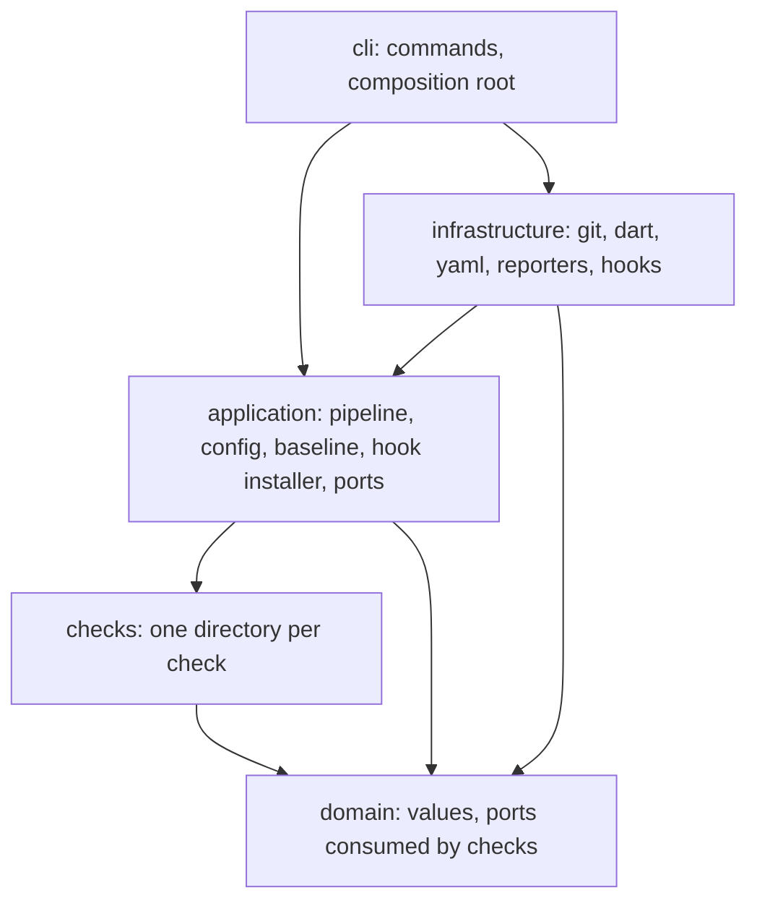

# Architecture

Status: **Approved (2026-11-12).** This document is the single source for structure, names and dependency rules. Plans copy signatures from here; if a plan needs a name that is not here, the plan adds it here first.

## 1. Quality attributes, in priority order

1. **Correctness of the verdict.** The tool judges exactly the snapshot being published (ADR-0001, ADR-0007). A wrong "pass" is the worst failure.
2. **Determinism.** Same snapshot, same config, same tool version: same findings in the same order on every machine (ADR-0003).
3. **Latency.** A typical pre-commit finishes in 1–2 s. Every design choice that costs a process spawn or a full-repo scan must justify itself.
4. **Safety.** The tool mutates the index and installs hooks. It must never lose user work (ADR-0002, [`security.md`](engineering/security.md)).
5. **Replaceability of the Dart toolchain.** How diagnostics and formatting are produced is decided by the spike (ADR-0008) and may change again. Nothing outside one adapter may know.

## 2. Style: ports and adapters, five modules



| Module | Owns | May import | Must not import |
|---|---|---|---|
| `domain` | Value types, the `Check` contract, ports that checks consume | `dart:core`, `dart:async`, `dart:convert`, `dart:typed_data`, `package:meta`, `package:collection` | everything else, including `dart:io` |
| `checks` | Rule logic, one directory per check | `domain` and everything `domain` may import, plus `package:pub_semver` | `application`, `infrastructure`, `cli`, `dart:io`, `package:analyzer`, `package:yaml` |
| `application` | Use cases, pipeline, config model, baseline, finding filters, ports for the outside world | `domain`, `checks`, `package:glob`, `package:pub_semver`, `package:crypto` | `infrastructure`, `cli`, `dart:io` |
| `infrastructure` | Adapters: git, Dart toolchain, YAML/JSON readers, reporters, file system | `domain`, `application`, any dependency, `dart:io` | `cli`, `checks` |
| `cli` | Argument parsing, exit codes, the composition root | everything | n/a |

Rules that follow from the table:

- **Only `cli/composition.dart` constructs infrastructure classes.** Everything else receives ports through constructors. No service locator, no global state, no singletons.
- **`dart:io` exists only in `infrastructure` and `cli`.** `Platform.environment`, `stdin`, `stdout`, `File`, `Process` and `exit` are never touched elsewhere.
- **A check is pure.** Given the same `CheckContext` answers it returns the same result. It never spawns a process, reads the clock, or reads the working tree.
- The table is enforced by `test/architecture/layering_test.dart`, which parses the import directives of every file under `lib/src` and fails on a forbidden edge. The test is written in plan 01, task 1, before any production code.

`CLAUDE.md` lists four layers. `checks` is carved out of the domain layer so that the rule "a check may only see the domain" is checkable by path.

## 3. Package layout

```
bin/stagelatch.dart                  # main(): delegates to cli, sets exitCode
lib/
  stagelatch.dart                    # public barrel; exports only `packageVersion` until 1.0.0
  src/
    domain/
      repo_path.dart                 # RepoPath
      rule_id.dart                   # RuleId, RuleDescriptor
      severity.dart                  # Severity, RuleLevel
      location.dart                  # Position, Location
      finding.dart                   # Finding
      fix.dart                       # Fix
      change_set.dart                # ChangeKind, FileChange, ChangeSet
      snapshot.dart                  # FileMode, SnapshotEntry, SnapshotFiles
      documents.dart                 # Documents, DocumentResult, LocatedNode and subtypes
      package_map.dart               # DartPackage, PackageMap
      check.dart                     # Check, CheckPhase, CheckResult, CheckContext, EntryKind
      dart/
        dart_toolchain.dart          # DartToolchain, DartDiagnostic, DiagnosticSeverity, FormatOutcome
        dart_file_facts.dart         # DartFileFacts, Directive, AnnotatedDeclaration, TestCall
        import_graph.dart            # ImportGraph
    checks/
      pubspec/  format/  analyze/  sensitive_files/
      codegen/  l10n/  assets/  tests/
    application/
      errors.dart                    # StagelatchException and subtypes
      entry_point.dart               # EntryPoint and subtypes, PushedRef
      environment.dart               # Environment (value object built by the cli)
      config/                        # Config, ConfigLoader, HookSelector, size/duration parsing
      pipeline/                      # Pipeline, CheckRegistry, finding filters, RunReport
      baseline/                      # Baseline, Fingerprint, BaselineStore port
      hooks/                         # HookInstaller, hook script template
      ports/                         # GitRepository, Reporter, HookStore, WorkingTree, Clock, ...
    infrastructure/
      git/                           # GitProcess, CatFileBatch, GitCliRepository, GitSnapshotFiles
      dart/                          # SdkLocator, DartToolchain adapter, fact extractor
      documents/                     # YamlDocuments, JsonDocuments
      reporters/                     # ConsoleReporter, JsonReporter, GithubReporter, ...
      io/                            # LocalWorkingTree, FileHookStore, SystemClock
    cli/
      runner.dart                    # StagelatchCommandRunner
      composition.dart               # the only place that wires adapters to ports
      exit_codes.dart                # ExitCode
      commands/                      # one file per command
test/
  architecture/  domain/  checks/  application/  infrastructure/  cli/
  acceptance/                        # real git repositories in temp directories
  support/                           # TempRepo, fakes for every port
```

Files stay small and single-purpose: one public type (plus its private helpers) per file, except closely related value types listed together above.

## 4. Domain model

The signatures below are canonical. Doc comments are omitted here for space; in code every public member has one. Constructors are shown with the class name for readability; code declares them with `new` and `factory` as [`coding-standards.md`](engineering/coding-standards.md#3-types-and-immutability) requires.

```dart
/// A repository-relative path: forward slashes, no leading slash, no `.`/`..`
/// segments, no NUL. The constructor throws [FormatException] otherwise.
final class RepoPath implements Comparable<RepoPath> {
  factory RepoPath(String value);
  String get value;
  String get basename;
  String get extension;            // includes the dot; '' when none
  RepoPath? get parent;            // null at the repository root
  bool isWithin(RepoPath directory);
}

final class RuleId implements Comparable<RuleId> {
  const RuleId(this.check, this.rule);
  factory RuleId.parse(String value);      // 'pubspec/path-dependency'
  final String check;
  final String rule;
}

final class RuleDescriptor {
  const RuleDescriptor({required this.id, required this.defaultSeverity, required this.summary, this.fixable = false});
}

enum Severity { warning, error }
enum RuleLevel { off, warning, error; Severity? get severity; }   // null for off

final class Position implements Comparable<Position> { const Position(this.line, this.column); }   // both 1-based
final class Location {
  const Location(this.path, this.start, this.end);   // end is exclusive
  const Location.wholeFile(RepoPath path);           // 1:1, for path-based findings
}

final class Finding {
  const Finding({required this.rule, required this.severity, required this.message, required this.location});
  static int compare(Finding a, Finding b);   // path, start, rule, message
}

/// Full replacement text for one file of the snapshot.
final class Fix {
  const Fix({required this.rule, required this.path, required this.content});
}

enum ChangeKind { added, modified, deleted, renamed, typeChanged }

final class FileChange {
  const FileChange({required this.path, required this.kind, this.previousPath});
}

final class ChangeSet {
  factory ChangeSet(Iterable<FileChange> changes);   // sorts; rejects a duplicate path
  final List<FileChange> changes;          // sorted by path, unmodifiable
  Iterable<FileChange> get present;        // everything except deleted
  bool get isEmpty;
  int get length;
  FileChange? operator [](RepoPath path);
}

final class DartPackage {
  const DartPackage({required this.root, required this.name, this.usesFlutter = false});   // null root: repository root
}

final class PackageMap {
  factory PackageMap(Iterable<DartPackage> packages);   // rejects a duplicate root
  final List<DartPackage> packages;        // sorted by root, repository root first
  DartPackage? packageOf(RepoPath path);   // deepest enclosing package
}
```

### 4.1 Ports consumed by checks

```dart
const int maxTextBytes = 5 * 1024 * 1024;   // largest file readText returns

enum FileMode { regular, executable, symlink, gitlink; bool get isFile; }

final class SnapshotEntry {
  const SnapshotEntry({required this.path, required this.mode, required this.blobId});
}

/// Read-only view of one snapshot: the index or a commit.
abstract interface class SnapshotFiles {
  Future<SnapshotEntry?> entry(RepoPath path);
  Future<List<SnapshotEntry>> list({RepoPath? under});   // sorted by path
  Future<Uint8List?> readBytes(RepoPath path);
  /// Null when the file is absent, binary, not valid UTF-8, a symlink or
  /// gitlink, or larger than 5 MiB.
  Future<String?> readText(RepoPath path);
  Future<int?> size(RepoPath path);
}

sealed class DocumentResult {}
final class DocumentMissing extends DocumentResult {}
final class DocumentInvalid extends DocumentResult { Location get location; String get reason; }
final class DocumentParsed extends DocumentResult { LocatedNode get root; }

sealed class LocatedNode { Location get location; }
final class LocatedMap extends LocatedNode { Map<String, LocatedEntry> get entries; }
final class LocatedList extends LocatedNode { List<LocatedNode> get items; }
final class LocatedScalar extends LocatedNode { Object? get value; }
final class LocatedEntry { Location get keyLocation; LocatedNode get value; }

abstract interface class Documents {
  Future<DocumentResult> yaml(SnapshotFiles files, RepoPath path);
  Future<DocumentResult> json(SnapshotFiles files, RepoPath path);
}

enum DiagnosticSeverity { error, warning, info }

final class DartDiagnostic {
  const DartDiagnostic({required this.location, required this.code, required this.severity, required this.message, this.correction});
}

sealed class FormatOutcome {}
final class Formatted extends FormatOutcome { String get text; }
final class Unparseable extends FormatOutcome {}

abstract interface class DartToolchain {
  Future<List<DartDiagnostic>> diagnose(Set<RepoPath> files);
  Future<FormatOutcome> format(RepoPath path, String source);
  /// Syntactic facts only. Null when the file is absent or does not parse.
  Future<DartFileFacts?> facts(SnapshotFiles files, RepoPath path);
  Future<void> close();
}
```

`DartToolchain` is the seam that makes ADR-0008 a one-adapter decision. `DartFileFacts` is why checks never see an AST (ADR-0013).

### 4.2 The check contract

```dart
enum CheckPhase { fix, verify }
enum EntryKind { preCommit, prePush, ci }

final class CheckResult {
  const CheckResult({this.findings = const [], this.fixes = const []});
}

abstract interface class Check {
  String get id;                         // 'pubspec'
  CheckPhase get phase;
  List<RuleDescriptor> get rules;
  /// True only for `analyze`, whose rule names come from the analyzer.
  bool get hasDynamicRules;
  Future<CheckResult> run(CheckContext context);
}

abstract interface class CheckContext {
  EntryKind get entry;
  ChangeSet get changes;
  SnapshotFiles get snapshot;
  SnapshotFiles? get base;               // null on the first commit
  PackageMap get packages;
  Documents get documents;
  DartToolchain get dart;                // started lazily on first use
  Future<ImportGraph> get importGraph;   // added in plan 02; built lazily, once per run
  TestRunner get tests;                  // since 0.3.0
  Future<Set<RepoPath>> get diverging;   // since 0.3.0; paths that differ from the working tree
  String? get targetBranch;
  bool isEnabled(RuleId rule);
  /// Typed parameters of the calling check, e.g. `AssetsSettings`.
  T settings<T extends Object>();
}
```

A check reports what it sees. It does not decide severity overrides, suppression, baseline or exit codes; the pipeline does.

## 5. Application layer

### 5.1 Entry points

```dart
sealed class EntryPoint { const EntryPoint(); }
final class PreCommitEntry extends EntryPoint {}
final class PrePushEntry extends EntryPoint { String get remote; List<PushedRef> get refs; }
final class CiEntry extends EntryPoint { String get baseRef; String get headRef; }

final class PushedRef {
  const PushedRef({required this.localRef, required this.localSha, required this.remoteRef, required this.remoteSha});
}
```

### 5.2 Ports to the outside world

```dart
sealed class SnapshotRef {}
final class IndexSnapshot extends SnapshotRef {}
final class CommitSnapshot extends SnapshotRef { String get sha; }

final class ResolvedRun {
  SnapshotRef get snapshot;
  SnapshotRef? get base;
  ChangeSet get changes;
  String? get targetBranch;
  String get label;                      // 'index', or the pushed ref name
}

abstract interface class GitRepository {
  Future<RepoLayout> layout();
  /// One element for pre-commit and ci; one per pushed branch for pre-push.
  Future<List<ResolvedRun>> resolve(EntryPoint entry, {required bool all});
  SnapshotFiles files(SnapshotRef ref);
  Future<Set<RepoPath>> divergingFromWorktree(SnapshotRef ref);
  /// Index snapshots only. Returns what was applied and whether the working
  /// tree copy was refreshed.
  Future<List<AppliedFix>> applyFixes(List<Fix> fixes);
  Future<void> close();
}

/// Receives every run of one invocation: one for pre-commit and ci, one per
/// pushed branch for pre-push.
abstract interface class Reporter { void report(List<RunReport> runs); }
abstract interface class Clock { Stopwatch stopwatch(); }
```

`HookStore`, `WorkingTree`, `BaselineStore`, `DartToolchainFactory` and `SdkLocator` follow the same shape and are specified in the plan that introduces them.

### 5.3 The pipeline

`Pipeline.run(RunRequest) -> Future<List<RunReport>>` is the one use case behind `run` and `ci` (ADR-0005). It returns one report per `ResolvedRun`. For each one:

1. **Load config** from the snapshot (ADR-0015). Invalid config throws `ConfigException`.
2. **Select** checks: the hook's selectors become a set of enabled `RuleId`s; a check runs when at least one of its rules is enabled.
3. **Fix phase** (ADR-0014): run checks with `CheckPhase.fix`. When the snapshot is the index and the check's `fix` setting is on, apply the fixes through `GitRepository.applyFixes` and reopen the snapshot. Otherwise keep their findings.
4. **Verify phase:** run the remaining checks concurrently with `Future.wait`, in registry order.
5. **Filter** findings through a fixed chain: rule selection, `rules:` levels, `exclude` globs, inline `stagelatch:ignore`, baseline.
6. **Sort** findings by `(path, line, column, rule, message)`. Completion order of futures never reaches the output.
7. **Time** each check with the injected `Clock`; compare the total with `time_budget` and set `budgetExceeded`. The budget never changes the findings (ADR-0003).
8. **Verdict:** `fail` when at least one finding has `Severity.error`, else `pass`.

```dart
final class RunRequest { EntryPoint get entry; bool get all; bool get allowFixes; }
enum Verdict { pass, fail }

final class RunReport {
  EntryKind get entry;
  String get label;                      // from ResolvedRun.label
  int get files;                         // size of the changeset
  Verdict get verdict;
  List<Finding> get findings;
  List<AppliedFix> get fixes;
  List<CheckTiming> get timings;
  Duration get total;
  bool get budgetExceeded;
  int get suppressed;
  int get baselined;
  List<String> get notices;              // e.g. 'stagelatch.yaml is not staged'
}
```

### 5.4 Errors

```dart
sealed class StagelatchException implements Exception { String get message; }
final class UsageException extends StagelatchException {}      // exit 64
final class ConfigException extends StagelatchException { Location? get location; }   // exit 78
final class InternalException extends StagelatchException {}   // exit 70
```

- Problems in **user content** are findings, never exceptions. A broken `pubspec.yaml` yields `pubspec/unparseable`.
- Problems in **how the tool was invoked** are `UsageException`.
- Anything unexpected is caught once, in `cli/runner.dart`, and mapped to exit 70 with the check name and a bypass hint. No other `catch (Object)` exists in the codebase.

## 6. Infrastructure decisions that shape everything else

- **Snapshots are addressed by blob id.** `git ls-files -s -z` (index) or `git ls-tree -r -z` (commit) gives `path -> (mode, blob id)` once. Content is then read from one persistent `git cat-file --batch` by blob id. This avoids path quoting problems and gives every file a free content hash for caching.
- **Git is always spawned with an argument list**, never through a shell, with `-z` output wherever a path is printed.
- **The process environment is inherited unchanged by git** so that `GIT_INDEX_FILE`, `GIT_DIR` and `GIT_WORK_TREE`, which git sets while running a hook, are honored.
- **The working tree is written by git, not by us.** After an index fix, `git checkout-index` materializes the file, so line-ending and filter configuration apply.
- **The Dart toolchain adapter is created lazily.** A commit that touches only `pubspec.yaml` never starts it.

Details: [`specs/git.md`](specs/git.md), [`specs/dart-toolchain.md`](specs/dart-toolchain.md).

## 7. Determinism rules for all code

- No `DateTime.now()`, `Stopwatch()` or `Random` outside the `Clock` adapter.
- No iteration over a `HashMap`/`HashSet` that reaches output; sort first.
- No locale-dependent formatting. Numbers and paths are formatted by our own functions.
- Environment variables are read once, in `cli/composition.dart`, into an immutable `Environment` value.
- No network access anywhere. No dependency may open a socket.

## 8. Adding a check: the checklist

1. Add the rules to [`specs/rules.md`](specs/rules.md) with ID, default severity, message and location.
2. Create `lib/src/checks/<check>/` with the check class and its settings type.
3. Unit-test it with fakes of the domain ports; no git, no file system.
4. Register it in `application/pipeline/check_registry.dart`.
5. Add its settings to the config model, the config spec and the JSON Schema.
6. Add at least one acceptance scenario that commits a violating file.

## 9. What this architecture deliberately does not have

- No plugin loading before 1.0.0 ([`specs/custom-checks.md`](specs/custom-checks.md)).
- No daemon, unless the spike fails its latency target.
- No dependency injection framework, code generation or reflection.
- No abstraction over git itself: the git CLI is the only supported backend.
