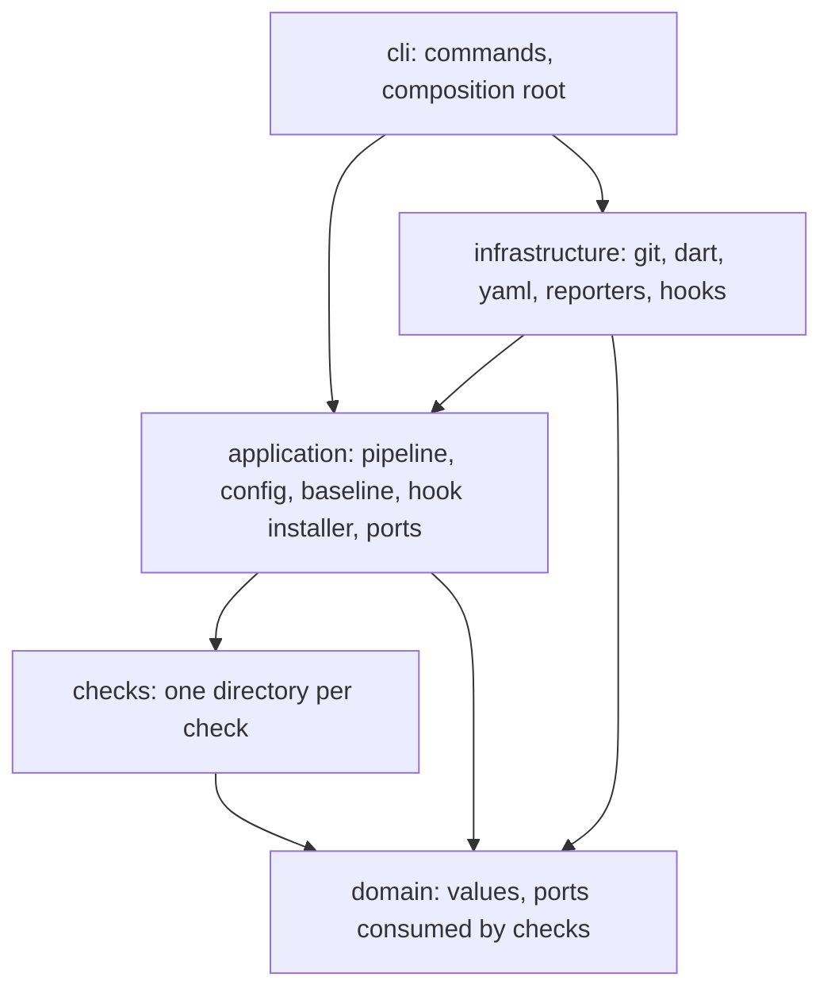

# Architecture

Status: **Approved (2026-11-12).** This document is the single source for structure, names and dependency rules. Plans copy signatures from here; if a plan needs a name that is not here, the plan adds it here first.

## 1. Quality attributes, in priority order

1. **Correctness of the verdict.** The tool judges exactly the snapshot being published (ADR-0001, ADR-0007). A wrong "pass" is the worst failure.
2. **Determinism.** Same snapshot, same config, same tool version: same findings in the same order on every machine (ADR-0003).
3. **Latency.** A typical pre-commit finishes in 1–2 s. Every design choice that costs a process spawn or a full-repo scan must justify itself.
4. **Safety.** The tool mutates the index and installs hooks. It must never lose user work (ADR-0002, [`security.md`](engineering/security.md)).
5. **Replaceability of the Dart toolchain.** Diagnostics and formatting come from the project's resolved SDK, through its analysis server and `dart format` (ADR-0008), and the mechanism may change again. Nothing outside one adapter may know.

## 2. Style: ports and adapters, five modules



| Module | Owns | May import | Must not import |
|---|---|---|---|
| `domain` | Value types, the `Check` contract, ports that checks consume | `dart:core`, `dart:async`, `dart:convert`, `dart:typed_data`, `package:meta`, `package:collection` | everything else, including `dart:io` |
| `checks` | Rule logic, one directory per check | `domain` and everything `domain` may import, plus `package:pub_semver` | `application`, `infrastructure`, `cli`, `dart:io`, `package:analyzer`, `package:yaml` |
| `application` | Use cases, pipeline, config model, baseline, finding filters, ports for the outside world | `domain`, `checks`, `package:glob`, `package:path` (its POSIX context only, for globs over repository paths), `package:pub_semver`, `package:crypto` | `infrastructure`, `cli`, `dart:io` |
| `infrastructure` | Adapters: git, Dart toolchain, YAML/JSON readers, reporters, file system | `domain`, `application`, any dependency, `dart:io` | `cli`, `checks` |
| `cli` | Argument parsing, exit codes, the composition root | everything | n/a |

Rules that follow from the table:

- **Only `cli/composition.dart` constructs infrastructure classes.** Everything else receives ports through constructors. No service locator, no global state, no singletons.
- **`dart:io` exists only in `infrastructure` and `cli`.** `Platform.environment`, `stdin`, `stdout`, `File`, `Process` and `exit` are never touched elsewhere.
- **A check is pure.** Given the same `CheckContext` answers it returns the same result. It never spawns a process, reads the clock, or reads the working tree.
- The table is enforced by `test/architecture/layering_test.dart`, which parses the import directives of every file under `lib/src` and fails on a forbidden edge. The test is written in plan 01, task 1, before any production code.

`CLAUDE.md` lists four layers. `checks` is carved out of the domain layer so that the rule "a check may only see the domain" is checkable by path.

## 3. Package layout

```
bin/stagelatch.dart                  # main(): delegates to cli, sets exitCode
lib/
  stagelatch.dart                    # public barrel; exports only `packageVersion` until 1.0.0
  src/
    domain/
      repo_path.dart                 # RepoPath
      rule_id.dart                   # RuleId, RuleDescriptor
      severity.dart                  # Severity, RuleLevel
      location.dart                  # Position, Location
      finding.dart                   # Finding
      fix.dart                       # Fix
      change_set.dart                # ChangeKind, FileChange, ChangeSet
      snapshot.dart                  # FileMode, SnapshotEntry, SnapshotFiles
      documents.dart                 # Documents, DocumentResult, LocatedNode and subtypes
      package_map.dart               # DartPackage, PackageMap
      check.dart                     # Check, CheckPhase, CheckResult, CheckContext, EntryKind
      dart/
        dart_toolchain.dart          # DartToolchain, DartDiagnostic, DiagnosticSeverity, FormatOutcome
        dart_file_facts.dart         # DartFileFacts, Directive, AnnotatedDeclaration, TestCall
        import_graph.dart            # ImportGraph
    checks/
      pubspec/  format/  analyze/  sensitive_files/
      codegen/  l10n/  assets/  tests/
    application/
      errors.dart                    # StagelatchException and subtypes
      entry_point.dart               # EntryPoint and subtypes, PushedRef
      environment.dart               # Environment (value object built by the cli)
      config/                        # Config, ConfigLoader, HookSelector, size/duration parsing
      pipeline/                      # Pipeline, CheckRegistry, finding filters, RunReport
      text/                          # sanitizeForTerminal (S5)
      baseline/                      # Baseline, Fingerprint, BaselineStore port
      hooks/                         # HookInstaller, hook script template, parsePushedRefs
      packages/                      # buildPackageMap
      doctor/                        # Doctor, ProbeResult
      ports/                         # GitRepository, Reporter, HookStore, WorkingTree, Clock, ...
    infrastructure/
      git/                           # GitProcess, CatFileBatch, GitCliRepository, GitSnapshotFiles
      dart/                          # FileSdkLocator, SdkDartToolchain(+Factory), MaterializedSnapshot,
                                     # AnalysisServerClient, SyntacticFacts (lexer and recognizers, ADR-0017)
      documents/                     # YamlDocuments, JsonDocuments
      reporters/                     # ConsoleReporter, ansi, console format, JsonReporter, GithubReporter, ...
      io/                            # LocalWorkingTree, FileHookStore, SystemClock, LocalDoctorProbes
    cli/
      runner.dart                    # StagelatchCommandRunner
      composition.dart               # the only place that wires adapters to ports
      exit_codes.dart                # ExitCode
      commands/                      # one file per command
test/
  architecture/  domain/  checks/  application/  infrastructure/  cli/
  acceptance/                        # real git repositories in temp directories
  support/                           # TempRepo, fakes for every port
```

Files stay small and single-purpose: one public type (plus its private helpers) per file, except closely related value types listed together above.

## 4. Domain model

The signatures below are canonical. Doc comments are omitted here for space; in code every public member has one. Constructors are shown with the class name for readability; code declares them with `new` and `factory` as [`coding-standards.md`](engineering/coding-standards.md#3-types-and-immutability) requires.

```dart
/// A repository-relative path: forward slashes, no leading slash, no `.`/`..`
/// segments, no NUL. The constructor throws [FormatException] otherwise.
final class RepoPath implements Comparable<RepoPath> {
  factory RepoPath(String value);
  String get value;
  String get basename;
  String get extension;            // includes the dot; '' when none
  RepoPath? get parent;            // null at the repository root
  bool isWithin(RepoPath directory);
}

final class RuleId implements Comparable<RuleId> {
  const RuleId(this.check, this.rule);
  factory RuleId.parse(String value);      // 'pubspec/path-dependency'
  final String check;
  final String rule;
}

final class RuleDescriptor {
  const RuleDescriptor({required this.id, required this.defaultSeverity, required this.summary, this.fixable = false});
}

enum Severity { warning, error }
enum RuleLevel { off, warning, error; Severity? get severity; }   // null for off

final class Position implements Comparable<Position> { const Position(this.line, this.column); }   // both 1-based
final class Location {
  const Location(this.path, this.start, this.end);   // end is exclusive
  const Location.wholeFile(RepoPath path);           // 1:1, for path-based findings
}

final class Finding {
  const Finding({required this.rule, required this.severity, required this.message, required this.location});
  static int compare(Finding a, Finding b);   // path, start, rule, message
}

/// Full replacement text for one file of the snapshot.
final class Fix {
  const Fix({required this.rule, required this.path, required this.content});
}

enum ChangeKind { added, modified, deleted, renamed, typeChanged }

final class FileChange {
  const FileChange({required this.path, required this.kind, this.previousPath});
}

final class ChangeSet {
  factory ChangeSet(Iterable<FileChange> changes);   // sorts; rejects a duplicate path
  final List<FileChange> changes;          // sorted by path, unmodifiable
  Iterable<FileChange> get present;        // everything except deleted
  bool get isEmpty;
  int get length;
  FileChange? operator [](RepoPath path);
}

final class DartPackage {
  const DartPackage({required this.root, required this.name, this.usesFlutter = false});   // null root: repository root
}

final class PackageMap {
  factory PackageMap(Iterable<DartPackage> packages);   // rejects a duplicate root
  final List<DartPackage> packages;        // sorted by root, repository root first
  DartPackage? packageOf(RepoPath path);   // deepest enclosing package
}
```

### 4.1 Ports consumed by checks

```dart
const int maxTextBytes = 5 * 1024 * 1024;   // largest file readText returns

enum FileMode { regular, executable, symlink, gitlink; bool get isFile; }

final class SnapshotEntry {
  const SnapshotEntry({required this.path, required this.mode, required this.blobId});
}

/// Read-only view of one snapshot: the index or a commit.
abstract interface class SnapshotFiles {
  Future<SnapshotEntry?> entry(RepoPath path);
  Future<List<SnapshotEntry>> list({RepoPath? under});   // sorted by path
  Future<Uint8List?> readBytes(RepoPath path);
  /// Null when the file is absent, binary, not valid UTF-8, a symlink or
  /// gitlink, or larger than 5 MiB.
  Future<String?> readText(RepoPath path);
  Future<int?> size(RepoPath path);
}

sealed class DocumentResult {}
final class DocumentMissing extends DocumentResult {}
final class DocumentInvalid extends DocumentResult { Location get location; String get reason; }
final class DocumentParsed extends DocumentResult { LocatedNode get root; }

sealed class LocatedNode { Location get location; }
final class LocatedMap extends LocatedNode { Map<String, LocatedEntry> get entries; }
final class LocatedList extends LocatedNode { List<LocatedNode> get items; }
final class LocatedScalar extends LocatedNode { Object? get value; }
final class LocatedEntry { Location get keyLocation; LocatedNode get value; }

abstract interface class Documents {
  Future<DocumentResult> yaml(SnapshotFiles files, RepoPath path);
  Future<DocumentResult> json(SnapshotFiles files, RepoPath path);
  DocumentResult parseYaml(String text, RepoPath path);   // text that is not in a snapshot
}

enum DiagnosticSeverity { error, warning, info }

final class DartDiagnostic {
  const DartDiagnostic({required this.location, required this.code, required this.severity, required this.message, this.correction});
}

sealed class FormatOutcome {}
final class Formatted extends FormatOutcome { String get text; }
final class Unparseable extends FormatOutcome {}

abstract interface class DartToolchain {
  Future<List<DartDiagnostic>> diagnose(Set<RepoPath> files);
  Future<FormatOutcome> format(RepoPath path, String source);
  /// Syntactic facts only. Null when the file is absent or does not parse.
  Future<DartFileFacts?> facts(SnapshotFiles files, RepoPath path);
  Future<void> close();
}
```

```dart
/// Edges from import, export and part directives; `part of` adds the
/// reverse edge (dart-toolchain.md section 3).
final class ImportGraph {
  factory ImportGraph.build({required Map<RepoPath, List<Directive>> directives, required PackageMap packages});
  Set<RepoPath> dependentsOf(Set<RepoPath> files);              // reverse transitive closure, inputs included, sorted
  List<RepoPath>? shortestChain(RepoPath from, RepoPath to);    // breadth-first, ties by path order
}
```

`DartToolchain` is the seam that makes ADR-0008 a one-adapter decision. `DartFileFacts` is why checks never see an AST (ADR-0013).

### 4.2 The check contract

```dart
enum CheckPhase { fix, verify }
enum EntryKind { preCommit, prePush, ci }

final class CheckResult {
  const CheckResult({this.findings = const [], this.fixes = const []});
}

abstract interface class Check {
  String get id;                         // 'pubspec'
  CheckPhase get phase;
  List<RuleDescriptor> get rules;
  /// True only for `analyze`, whose rule names come from the analyzer.
  bool get hasDynamicRules;
  Future<CheckResult> run(CheckContext context);
}

abstract interface class CheckContext {
  EntryKind get entry;
  ChangeSet get changes;
  SnapshotFiles get snapshot;
  SnapshotFiles? get base;               // null on the first commit
  PackageMap get packages;
  Documents get documents;
  DartToolchain get dart;                // started lazily on first use
  Future<ImportGraph> get importGraph;   // added in plan 02; built lazily, once per run
  TestRunner get tests;                  // since 0.3.0
  Future<Set<RepoPath>> get diverging;   // since 0.3.0; paths that differ from the working tree
  String? get targetBranch;
  bool isEnabled(RuleId rule);
  /// Typed parameters of the calling check, e.g. `AssetsSettings`.
  T settings<T extends Object>();
}
```

A check reports what it sees. It does not decide severity overrides, suppression, baseline or exit codes; the pipeline does.

## 5. Application layer

### 5.1 Entry points

```dart
sealed class EntryPoint { const EntryPoint(); }
final class PreCommitEntry extends EntryPoint {}
final class PrePushEntry extends EntryPoint { String get remote; List<PushedRef> get refs; }
final class CiEntry extends EntryPoint { String get baseRef; String get headRef; }

final class PushedRef {
  const PushedRef({required this.localRef, required this.localSha, required this.remoteRef, required this.remoteSha});
}
```

### 5.2 Ports to the outside world

```dart
sealed class SnapshotRef {}
final class IndexSnapshot extends SnapshotRef {}
final class CommitSnapshot extends SnapshotRef { String get sha; }

final class ResolvedRun {
  SnapshotRef get snapshot;
  SnapshotRef? get base;
  ChangeSet get changes;
  String? get targetBranch;
  String get label;                      // 'index', or the pushed ref name
}

abstract interface class GitRepository {
  Future<RepoLayout> layout();
  /// One element for pre-commit and ci; one per pushed branch for pre-push.
  Future<List<ResolvedRun>> resolve(EntryPoint entry, {required bool all});
  SnapshotFiles files(SnapshotRef ref);
  Future<Set<RepoPath>> divergingFromWorktree(SnapshotRef ref);
  /// Index snapshots only. Returns what was applied and whether the working
  /// tree copy was refreshed. Afterwards, files(IndexSnapshot()) is a view
  /// of the updated index.
  Future<List<AppliedFix>> applyFixes(List<Fix> fixes);
  Future<void> close();
}

/// Receives every run of one invocation: one for pre-commit and ci, one per
/// pushed branch for pre-push.
abstract interface class Reporter { void report(List<RunReport> runs); }
abstract interface class Clock { Duration get elapsed; }   // monotonic; only differences matter
```

`HookStore`, `WorkingTree` and `BaselineStore` follow the same shape and are specified in the plan that introduces them. Plan 02 adds these ports:

```dart
enum SdkSource { sdkPath, fvm, path }
final class ResolvedSdk {
  String get root;                       // the Dart SDK root
  String get dartExecutable;
  String? get flutterExecutable;
  String get version;
  SdkSource get source;
}
abstract interface class SdkLocator { Future<ResolvedSdk> locate(Config config); }

/// Creating starts no process and writes no file (dart-toolchain.md section 7).
abstract interface class DartToolchainFactory {
  DartToolchain create({required ResolvedSdk sdk, required String repoRoot, required SnapshotFiles snapshot, required PackageMap packages, required Set<String> testFunctions});
}

abstract interface class DoctorProbes {
  Future<String?> gitVersion();                          // first line of `git --version`
  Future<String?> resolveOnPath(String name);
  Future<bool> globallyActivated();                      // <pub cache>/global_packages/stagelatch
  Future<bool> packageConfigExists(RepoPath? packageRoot);
}

// GitRepository gains, for `run pre-push` without stdin (cli.md 3.4):
Future<PrePushEntry> synthesizePrePush({String? remote});
```

### 5.3 The pipeline

`Pipeline.run(RunRequest) -> Future<List<RunReport>>` is the one use case behind `run` and `ci` (ADR-0005). It returns one report per `ResolvedRun`. For each one:

1. **Load config** from the snapshot (ADR-0015). Invalid config throws `ConfigException`.
2. **Select** checks: the hook's selectors become a `Selection`. A whole-check selector enables every rule of that check, including the open-ended rule names of `analyze`; a check runs when it is selected whole or by at least one rule.
3. **Fix phase** (ADR-0014): run checks with `CheckPhase.fix`, one at a time. When the snapshot is the index and fixes are allowed, apply each returned fix whose finding survives the filters of step 5 (so a rule that is off, or an excluded path, is never fixed) through `GitRepository.applyFixes`, and reopen the snapshot. A fixed finding becomes an `AppliedFix`; without fixing, the findings are kept.
4. **Verify phase:** run the remaining checks concurrently with `Future.wait`, in registry order.
5. **Filter** findings through a fixed chain: rule selection, `rules:` levels, `exclude` globs, inline `stagelatch:ignore`, baseline.
6. **Sort** findings by `(path, line, column, rule, message)`. Completion order of futures never reaches the output.
7. **Time** each check with the injected `Clock`; compare the total with `time_budget` and set `budgetExceeded`. The budget never changes the findings (ADR-0003).
8. **Verdict:** `fail` when at least one finding has `Severity.error`, else `pass`.

```dart
final class RunRequest { EntryPoint get entry; bool get all; bool get allowFixes; String? get hook; bool get useBaseline; }   // hook and useBaseline: plan 03 Task 7 (baseline create and prune)
enum Verdict { pass, fail }

final class RunReport {
  EntryKind get entry;
  String get label;                      // from ResolvedRun.label
  int get files;                         // size of the changeset
  bool get all;                          // the run used --all (plan 03 Task 8); the console header and the JSON report show it
  Verdict get verdict;
  List<Finding> get findings;
  List<AppliedFix> get fixes;
  List<CheckTiming> get timings;
  Duration get total;
  Duration get timeBudget;               // config.timeBudget, for the budget note
  bool get budgetExceeded;
  int get suppressed;
  int get baselined;
  List<String> get notices;              // e.g. 'stagelatch.yaml is not staged'
}
```

### 5.3.1 Toolchain lifecycle in a run

- `Pipeline` receives `SdkLocator` and `DartToolchainFactory` through its constructor; `Composition.create` wires `FileSdkLocator` and `SdkDartToolchainFactory`.
- `context.dart` creates a toolchain on first access through `DartToolchainFactory`, after `SdkLocator.locate`. A run in which no check touches it locates no SDK and starts nothing.
- The fix phase and the verify phase each have their own context, so each has its own toolchain, bound to the snapshot view of that phase. Concurrent verify checks share one. Every toolchain is closed in a `finally` around the run.
- `context.packages` is `buildPackageMap(snapshot, documents)`; `context.importGraph` is built once per context from `dart.facts` of every `.dart` file of the snapshot.
- `dart.facts` takes the snapshot to read, so a check asks for the facts of the base through `context.base`. `LazyToolchain` passes `tests.functions` to `DartToolchainFactory.create` (plan 03 Task 6); there is no facts cache before plan 04.

### 5.3.2 Other application functions added in plan 02

```dart
// pipeline/inline_ignore.dart (baseline-and-suppression.md section 2)
final class IgnoreId { String get text; int get column; }
final class IgnoreDirective { int get line; List<IgnoreId> get ids; }
List<IgnoreDirective> scanIgnores(String text, {required String commentOpener});
String? commentOpenerFor(RepoPath path);                 // '//', '#' or null
final class IgnoreOutcome { List<Finding> get kept; int get suppressed; List<Finding> get invalid; }
Future<IgnoreOutcome> applyInlineIgnores(List<Finding> findings, {required SnapshotFiles snapshot, required ChangeSet changes, required CheckCatalog catalog});

// packages/package_map_builder.dart (dart-toolchain.md section 2)
Future<PackageMap> buildPackageMap(SnapshotFiles snapshot, Documents documents);

// hooks/pushed_refs.dart (git.md section 4.2)
List<PushedRef> parsePushedRefs(String stdin);           // throws UsageException

// doctor/ (cli.md section 3.6)
enum ProbeStatus { ok, warn, fail }
final class ProbeResult { String get id; ProbeStatus get status; String get message; }
final class Doctor {
  Doctor({required GitRepository git, required HookStore hooks, required ConfigLoader loader, required Documents documents, required WorkingTree worktree, required CheckCatalog catalog, required SdkLocator sdk, required Environment environment, required DoctorProbes probes, required Version toolVersion});
  Future<List<ProbeResult>> run();                       // D1 to D9, in order
}
```

### 5.4 Errors

```dart
sealed class StagelatchException implements Exception { String get message; }
final class UsageException extends StagelatchException {}      // exit 64
final class ConfigException extends StagelatchException { Location? get location; }   // exit 78
final class InternalException extends StagelatchException {}   // exit 70
```

- Problems in **user content** are findings, never exceptions. A broken `pubspec.yaml` yields `pubspec/unparseable`.
- Problems in **how the tool was invoked** are `UsageException`.
- Anything unexpected is mapped to exit 70 with a bypass hint. Two places catch everything, and no other does: `Pipeline`, around each check, because only there is it still known which check was running; and `cli/runner.dart`, around the whole command.

### 5.5 Infrastructure added in plan 02

```dart
// dart/
final class FileSdkLocator implements SdkLocator { FileSdkLocator({required String repoRoot, required Environment environment}); }
final class SyntacticFacts {                             // the lexer of dart-toolchain.md section 6, ADR-0017; from plan 03, directives plus declarations and calls
  const SyntacticFacts({Set<String> testFunctions = const {'test', 'testWidgets', 'group'}});   // the set is wired in plan 03 Task 6
  DartFileFacts extract(String source, RepoPath path);   // never throws; isWellFormed false when the lexer finds an unterminated string or comment, or unpaired brackets
}
final class MaterializedSnapshot {                       // ADR-0001; dart-toolchain.md section 4
  static Future<MaterializedSnapshot> write({required SnapshotFiles snapshot, required String repoRoot, required Iterable<DartPackage> packages, bool settingsOnly = false});
  String get root;
  String pathOf(RepoPath path);
  RepoPath? repoPathOf(String absolutePath);
  Future<void> delete();
}
final class AnalysisServerClient {
  static Future<AnalysisServerClient> start(String dartExecutable);
  Future<Map<String, Object?>> request(String method, Map<String, Object?> params);
  Future<void> close();
}
final class SdkDartToolchainFactory implements DartToolchainFactory {}
final class SdkDartToolchain implements DartToolchain {}

// reporters/
final class JsonReporter implements Reporter { JsonReporter(StringSink out, {required String toolVersion}); }
String renderErrorJson({required String kind, required String message, required int exitCode});
final class GithubReporter implements Reporter { GithubReporter(StringSink out); }
String escapeWorkflowData(String value);
String escapeWorkflowProperty(String value);
String summaryLine(RunReport report);                    // shared by the console and GitHub reporters

// io/
final class LocalDoctorProbes implements DoctorProbes {}
```

### 5.6 Added in plan 03

```dart
// domain/dart/dart_file_facts.dart
//   DartFileFacts gains: bool get isWellFormed;           // ADR-0017; true unless the lexer finds an unterminated string or block comment, or unpaired brackets
// domain/ports
abstract interface class DartToolchainFactory {
  DartToolchain create({required ResolvedSdk sdk, required String repoRoot, required SnapshotFiles snapshot, required PackageMap packages, required Set<String> testFunctions});
}

// checks/l10n/
Set<String> icuArguments(String message);                                   // never throws; explicit stack, no recursion
Future<L10nSetup?> readL10nSetup(SnapshotFiles files, Documents documents, DartPackage package);
final class L10nSetup { RepoPath get arbDir; String get templateFile; RepoPath? get outputDir; }
final class L10nCheck implements Check {}                                    // id 'l10n'; rules missing-key, placeholder-mismatch, unparseable

// checks/pubspec/
List<Finding> unpinnedGitFindings(PubspecDocument document, RepoPath path, {required bool requireSha});
List<Finding> buildNumberRegressionFindings({required PubspecDocument snapshot, required PubspecDocument? base, required RepoPath path});
List<Finding> lockfileFindings({required PubspecDocument pubspec, required LockfileDocument lock, required RepoPath pubspecPath});
final class LockedPackage { String get version; String get source; String get dependencyKind; }   // source: hosted | git | path | sdk
final class LockfileDocument { Map<String, LockedPackage> get packages; }

// checks/assets/
final class AssetDeclarations { factory AssetDeclarations.fromPubspec(PubspecDocument document, RepoPath pubspecPath); bool declares(RepoPath file); Iterable<DeclaredAsset> get entries; }
String formatSize(int bytes, {required int limit});
final class AssetsCheck implements Check {}                                  // id 'assets'; rules missing, undeclared, max-file-size

// checks/codegen/
final class CodegenSignature { factory CodegenSignature.of(DartFileFacts facts, List<String> suffixes); List<String> get generatedParts; SignatureDifference? firstDifference(CodegenSignature? base); }
final class SignatureDifference { String get declaration; Location? get location; }   // null location: use the part directive
final class CodegenCheck implements Check {}                                 // id 'codegen'; rule stale

// checks/tests/
String testKey(TestCall call);                                               // groups, then the description
bool isTestFile(RepoPath path, PackageMap packages);
final class TestsCheck implements Check {}                                   // id 'tests'; rules solo, new-skip (affected: plan 04)

// infrastructure/dart/
final class SyntacticFacts { const SyntacticFacts({Set<String> testFunctions}); DartFileFacts extract(String source, RepoPath path); }

// application/baseline/
String normalizeSnippet(List<String> lines);
Future<String> fingerprintOf(Finding finding, SnapshotFiles snapshot);       // SHA-256 (package:crypto) of rule, path and normalized snippet
final class BaselineEntry { RuleId get rule; RepoPath get path; String get fingerprint; int get count; }
final class Baseline { const Baseline(List<BaselineEntry> entries); static const Baseline empty; List<BaselineEntry> get entries; }
Baseline decodeBaseline(String json);                                        // ConfigException on malformed input
String encodeBaseline(Baseline baseline);                                    // sorted by (path, rule, fingerprint)
final class BaselineOutcome { List<Finding> get kept; int get baselined; }
Future<BaselineOutcome> applyBaseline(List<Finding> findings, Baseline baseline, SnapshotFiles snapshot);   // findings already globally sorted
final class BaselineCommands { BaselineCommands(Pipeline pipeline, WorkingTree workingTree); Future<String> create({required bool force}); Future<String> prune(); }
```

- The baseline filter is not part of the per-check chain: `Pipeline` sorts all findings, applies the baseline, then appends `stagelatch/invalid-ignore` findings and sorts again.
- `GitRepository.resolve(entry, all: true)` is implemented (plan 03 Task 8); it no longer throws.

## 6. Infrastructure decisions that shape everything else

- **Snapshots are addressed by blob id.** `git ls-files -s -z` (index) or `git ls-tree -r -z` (commit) gives `path -> (mode, blob id)` once. Content is then read from one persistent `git cat-file --batch` by blob id. This avoids path quoting problems and gives every file a free content hash for caching.
- **Git is always spawned with an argument list**, never through a shell, with `-z` output wherever a path is printed.
- **The process environment is inherited unchanged by git** so that `GIT_INDEX_FILE`, `GIT_DIR` and `GIT_WORK_TREE`, which git sets while running a hook, are honored.
- **The working tree is written by git, not by us.** After an index fix, `git checkout-index` materializes the file, so line-ending and filter configuration apply.
- **The Dart toolchain adapter is created lazily.** A commit that touches only `pubspec.yaml` never starts it.
- **Dart analysis runs on a materialized snapshot** (ADR-0001): the snapshot's Dart and YAML files written into a temporary directory with the package configs, never the working tree with overlays.

Details: [`specs/git.md`](specs/git.md), [`specs/dart-toolchain.md`](specs/dart-toolchain.md).

## 7. Determinism rules for all code

- No `DateTime.now()`, `Stopwatch()` or `Random` outside the `Clock` adapter.
- No iteration over a `HashMap`/`HashSet` that reaches output; sort first.
- No locale-dependent formatting. Numbers and paths are formatted by our own functions.
- Environment variables are read once, in `cli/composition.dart`, into an immutable `Environment` value.
- No network access anywhere. No dependency may open a socket.

## 8. Adding a check: the checklist

1. Add the rules to [`specs/rules.md`](specs/rules.md) with ID, default severity, message and location.
2. Create `lib/src/checks/<check>/` with the check class and its settings type.
3. Unit-test it with fakes of the domain ports; no git, no file system.
4. Register it in `application/pipeline/check_registry.dart`.
5. Add its settings to the config model, the config spec and the JSON Schema.
6. Add at least one acceptance scenario that commits a violating file.

## 9. What this architecture deliberately does not have

- No plugin loading before 1.0.0 ([`specs/custom-checks.md`](specs/custom-checks.md)).
- No daemon in `0.1.0`. The spike missed its latency target and the owner chose one-shot runs with `analyze` off the default `pre-commit` list (ADR-0008); a daemon needs its own ADR.
- No dependency injection framework, code generation or reflection.
- No abstraction over git itself: the git CLI is the only supported backend.
